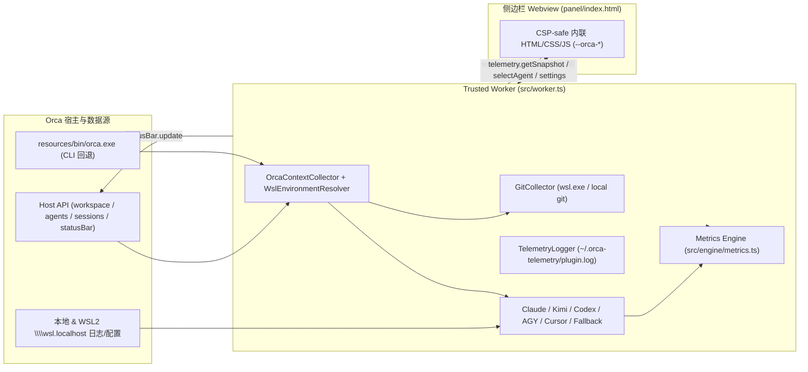

# 系统架构与数据流

本文档说明 `dorajasmine.agent-telemetry` 的整体运行时架构、Windows + WSL2 混合环境适配机制、Worker 并发防竞态设计以及 Panel ↔ Worker 通信契约。

## 总体拓扑

插件由 Orca 宿主的 `trusted-worker` 与右侧边栏 Webview（`panel/index.html`）两部分组成，所有 I/O、WSL 命令调用与增量文件解析全部收口在 Worker 侧执行，面板仅负责纯展示与交互事件下发：

## 运行时采集链路

每次快照刷新（`buildSnapshotForContext`）按以下顺序完成数据汇聚：

1. **Orca 上下文采集（`OrcaContextCollector.collect`）**：
   - 调用 `workspace.readContext` 获取当前聚焦工作区 ID、名称、分支与打开的终端。
   - 调用 `workspace.list` 补充工作区路径（`rawPath`）与 `hostId`。
   - 调用 `agents.list` 获取会话列表；当宿主的 `agents.list({ workspaceId })` 因 Paired Environment 抛出 `selector_not_found` 时，记录进 `unsupportedWorkspaceIds` 并立即退回无过滤全量查询，避免后续重复报错。
   - **Paired WSL 回退**：当 Orca Host API 未返回本地路径或 `hostAgents` 为空时，自动执行 `orca environment list --json`（非空结果缓存 5 分钟）与 `orca worktree ps --environment <envId> --json`（普通轮询缓存 `2.5s`，两阶段切换首帧允许使用 `15s` 内缓存），识别 `worktree` 中的 Native Chat 会话（`structured-agent-session-*`）并按活动状态与 `updatedAt`/`stateStartedAt` 降序排列。
2. **WSL 环境与路径映射（`WslEnvironmentResolver`）**：
   - 通过 `parseWslUncPath` 与 `toWslUncPath` 在 `\\wsl.localhost\<distro>\...` 和 POSIX 路径 `/home/...` 之间双向转换。
   - 使用 `wsl.exe -l --running -q` 获取已启动的发行版（绝不启动休眠发行版），按“当前工作区 WSL 发行版 home -> Windows 本机 home -> 其他运行中发行版 home”的顺序生成 `HomeRoot[]`。
   - **子进程环境净化与修复（`buildCleanChildEnv`）**：Orca `trusted-worker` 会注入 `ELECTRON_RUN_AS_NODE=1` 并剥离环境变量中的 `APPDATA`/`LOCALAPPDATA`/`USERPROFILE`；因此在派生 `resources/bin/orca.exe` 或 `git`/`wsl.exe` 时，插件会剥离 Electron/Orca 包装变量，利用 `os.homedir()` 重建 Windows 目录变量，注入 `WSL_UTF8=1`，并在 `decodeProcessBuffer` 中兼容解码偶发的 UTF-16LE 空字节流。
3. **目标会话选择与 Adapter 执行**：
   - `pickActiveAgent` 在未手工固定会话（`pinnedAgentKey === null`）时按 `working -> blocked -> waiting -> 最新活跃时间` 选取默认跟踪对象（`Auto Follow`）；若用户点击某个会话 Pill，则锁定到该 `pinnedAgentKey`。
   - 根据 `activeAgent.agent` 路由到对应 Adapter（详见 [adapters.md](./adapters.md)），增量读取新追加行并解析成 `ParsedTurn[]`。
   - 当存在 Cursor 工作区时，同时同步检查/维护目标环境下的 `~/.cursor/hooks.json` 状态。
4. **并行 Git 采集与指标计算**：
   - `GitCollector.collect` 对 WSL 工作区使用 `wsl.exe -d <distro> -- git -C <linuxPath> ...` 原生执行 `status --porcelain=v2 --branch`、`diff --numstat`、`diff --cached --numstat` 与 `log -1`，规避 Windows 经由 9P 访问 Linux 仓库造成的性能瓶颈与权限位/CRLF 假变更，结果按工作区键缓存 `3.5s`。
   - `computeMetrics` 汇总上下文百分比、Token 分类、估算费用与多维度 `tok/s`。

## 并发防护、实时性与自适应调度

### 1. Epoch 并发守卫与响应丢弃
快速切换工作区或连续点击不同会话 Pill 时，先发出的慢异步请求可能在较新切换完成之后才返回。`src/worker.ts` 维护两个单调递增计数器：
- `contextEpoch`：在 `workspace.changed`、`workspace.created`、`workspace.removed` 或强刷触发时递增；若采集前后 `contextEpoch` 不一致则立即丢弃过期快照。
- `selectionEpoch`：在 `telemetry.selectAgent` 触发时递增，并同步更新 `pinnedAgentKey`，防止上一条慢轮询覆盖用户刚刚选中的会话卡片。

### 2. 即时缓存切换 + 两阶段工作区同步
- **`telemetry.selectAgent`**：点击界面 Pill 时，先用内存最近一次工作区会话列表即时重算切换目标并立即推送新快照（体感 0 延迟），再视需要后台补充刷新。传入 `agentKey: "__auto__"` 可清除 `pinnedAgentKey` 恢复 Auto Follow。
- **两阶段 `workspace.changed`**：收到工作区切换事件时，Phase 1 先带 `preferCachedCli: true` 快速渲染新工作区（利用 `15s` CLI 缓存避免卡顿）；Phase 2 在背后立即发起无缓存完整 refresh 对齐最新终端列表与 Git 状态。

### 3. 实时事件叠加（`applyLiveActivityOverlay`）
在轮询间隙，Worker 通过订阅 `agent.status.changed` 以及 `agent.prompt.before` / `agent.tool.after` Hook 更新内存态的运行状态与提示时间锚点（`PromptTimingHint`），确保会话开始工作的毫秒级内界面立即变为 `Working` 且不丢失本轮延迟计时。

### 4. 可见性感知轮询间隔
`worker.ts` 根据面板是否折叠/隐藏（`telemetry.setPanelVisible`）以及当前工作区是否存在 `working` Agent 动态调度下一次 Timer：

| 面板可见性 | 工作区状态 | 采样间隔 |
| :--- | :--- | :--- |
| 可见 (`true`) | 有 Agent `working` | `Math.min(refreshIntervalMs, 1000)`（上限 1s） |
| 可见 (`true`) | 全部空闲 | `refreshIntervalMs`（默认 `2000ms`） |
| 隐藏 (`false`) | 有 Agent `working` | `10000ms` |
| 隐藏 (`false`) | 全部空闲 | `60000ms` |

> **关键设计**：`JsonlTailer` 主动选用受控轮询 + `fs.stat` 字节偏移增量读取（单次上限 `8 MiB`，遇到未以 `\n` 结尾的半行自动保留待下次补全），而不是 `fs.watch`——因为 Windows 访问 WSL2 `\\wsl.localhost`（9P 协议）时 `fs.watch` 事件极易丢失且容易泄露文件句柄。

## Panel ↔ Worker 通信契约

契约定义集中于 [src/protocol.ts](../src/protocol.ts)，通过 `declare module 'orca'` 对 `PluginRequests` 和 `PluginPanelEvents` 进行静态类型扩展：

| 通道名 | 类型 | 入参 (`input`) | 返回 / 负载 (`output`) | 说明 |
| :--- | :--- | :--- | :--- | :--- |
| `telemetry.getSnapshot` | Request | `{ selectedAgentKey?: string; forceRefresh?: boolean }` | `TelemetrySnapshot` | 首屏拉取或手动点击右上角刷新按钮 |
| `telemetry.selectAgent` | Request | `{ agentKey: string }` | `TelemetrySnapshot` | 切换固定查看的会话，传入 `"__auto__"` 切回 Auto Follow |
| `telemetry.setPanelVisible` | Request | `{ visible: boolean }` | `{ ok: true }` | 面板显隐通知，切换后台节能/前台高频调度 |
| `telemetry.toggleCursorHook` | Request | `{ enabled: boolean }` | `TelemetrySnapshot` | 安装或清理 `~/.cursor/hooks.json` 中的插件条目 |
| `telemetry.updateSettings` | Request | `{ showStatusBar?: boolean; showEstimatedCost?: boolean }` | `TelemetrySnapshot` | 同步持久化的面板显示设置并重推快照 |
| `telemetry.updated` | Panel Event | — | `TelemetrySnapshot` | Worker 主动广播给面板的最新全量遥测快照 |
